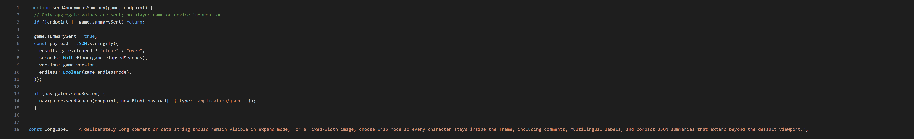

# Codeframe Shot

Turn any source-file line range into a crisp, line-numbered code image. The tool writes a self-contained HTML preview and asks a locally installed Chrome, Edge, or Chromium to render it headlessly. It does not open desktop windows or send source code anywhere.

[简体中文说明](README.zh-CN.md)

## Features

- Select inclusive source line ranges, with original line numbers preserved.
- Render VS Code-inspired dark or clean paper themes.
- Expand the image to fit long lines, or wrap them to a fixed width.
- Estimate image height from the selected lines and verify the resulting PNG dimensions.
- Keep the HTML beside the PNG for review and regeneration.
- Use optional Pygments syntax highlighting; the base renderer needs only Python's standard library and a Chromium browser.
- Add the source filename, selected range, and whole-file SHA-256 as non-visible HTML metadata.

## Example



## Requirements

- Python 3.9 or newer
- Chrome, Edge, or Chromium
- Optional: Pygments for syntax highlighting (`python -m pip install Pygments`)

## Quick start on Windows

```powershell
python .\codeframe_shot.py .\examples\demo.js --range 1-18
```

By default, the tool writes `codeframe-output\demo-lines-1-18.html` and `.png`. It searches common Chrome and Edge install locations. If the browser is elsewhere, pass its executable:

```powershell
python .\codeframe_shot.py .\path\to\source.js --range 454-466 `
  --browser "C:\Program Files\Google\Chrome\Application\chrome.exe" `
  --output-dir .\out
```

Use `--long-lines wrap` to fit extra-long lines inside the default 1700 CSS-pixel viewport. The default `expand` mode keeps source lines intact and widens the image when needed. PNG pixel dimensions are the CSS viewport dimensions multiplied by `--scale` (default `2`).

## Options

```text
--range START-END       Inclusive one-based range; omit to render the whole file
--output-dir PATH       Output folder (default: ./codeframe-output)
--browser PATH          Chrome/Edge/Chromium executable, auto-detected by default
--theme NAME            vscode-dark or paper
--language NAME         Pygments lexer name; normally inferred from file extension
--encoding NAME         Source encoding (default: utf-8-sig)
--font-size N           CSS font size in px (default: 14)
--line-height N         CSS line-height multiplier (default: 1.5)
--padding N             Outer padding in CSS px (default: 12)
--width N               Minimum CSS viewport width (default: 1700)
--scale N               Device scale factor (default: 2)
--long-lines MODE       expand or wrap (default: expand)
--no-line-numbers       Hide the gutter
--no-highlight          Disable Pygments highlighting
--force                 Replace existing output files
```

## Privacy and accuracy

Rendering happens locally. The browser receives only a `file:///` URL to the generated HTML; the tool disables background networking and uses a temporary browser profile. No analytics or telemetry are included.

The HTML records only the source basename, selected line range, and SHA-256 digest in a comment; it does not embed the absolute source path. The tool escapes source text before adding markup. Review the generated HTML and PNG before publishing, especially when source lines contain secrets or when wrapping very long lines.

This is a source-code illustration renderer. It does not execute programs and its PNG is not evidence that the displayed code was run.

## License

MIT. See [LICENSE](LICENSE).
